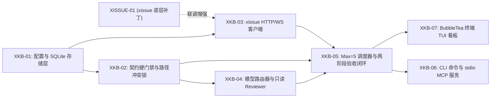

# xkb 详细开发任务拆解清单 (TASKS v1.0)

> **v1.1 粒度说明（优先于本文旧拆分）**：本文是 xkb 首次开发的追溯清单，不是当前拆卡模板。当前门禁要求 `small` 卡最多 2 条 `touches`、验收预算 2 文件/120 行；`large` 最多 3 条 `touches`、4 文件/300 行。实际拆卡必须按 [xkb-planner SKILL](../../skills/xkb-planner/SKILL.md) 的微卡规则执行，单卡目标 2~5 分钟；下文中跨 7 个文件的 `XISSUE-01` 与 `size=large` 的 `XKB-05` 仅作历史参考，不能直接复用。

本文档将 [SPEC.md](./SPEC.md) 拆解为 **1 个底层 `xissue` 配合补丁 + 7 个 `xkb` 独立原子任务**。每个任务均遵循“最多触碰 1~3 个包、边界清晰、单条命令可验收”原则，可直接交给任意开发者或编码 Agent 按序执行。

---

## 0. 任务依赖拓扑图



---

## 阶段 A：`xissue` 底层配合任务（在 `/Users/gouki/server/wwwroot/xpier/xissue` 执行）

### [XISSUE-01] 补齐本地 Rebase 合入、Diff/Worktree 暴露与单条/定量归档
- **优先级**：`P0`
- **工作目录**：`/Users/gouki/server/wwwroot/xpier/xissue`
- **修改范围 (`touches`)**：
  - `internal/gitx/gitx.go`
  - `internal/runner/runner.go`
  - `internal/runner/runner_workspace.go`
  - `internal/runner/issue_archive.go`
  - `internal/store/store.go`
  - `internal/config/config.go`
  - `internal/server/handlers_runs.go`
- **禁区 (`out_of_scope`)**：
  - 严禁修改 Web 前端代码（`web/`）；严禁破坏现有 `PR` 与 `push` 提交模式。
- **实现要求**：
  1. **`MergeBranchToTarget` 自动 Rebase 与分支清理**（`internal/gitx/gitx.go`）：
     - 在合入前，先在 `wtDir` 执行 `git fetch origin <targetBranch>` 与 `git rebase origin/<targetBranch>`；若冲突则 `git rebase --abort` 并返回明确错误。
     - 合入 `remoteURL` 成功后，在 `remoteURL` 与 `mirrorPath` 执行 `git branch -D <sourceBranch>` 清理临时分支。
  2. **`GET /api/runs/{id}/changes` 返回 `worktreePath` 与 `patch`**：
     - `RepoChanges` 增加 `WorktreePath string` (`json:"worktreePath"`) 与 `Patch string` (`json:"patch,omitempty"`)。
     - 当 URL 带 `?patch=1` 时，生成相对于 `mergeBase` 的 unified diff（含 untracked 新增文件，上限 256KB）。
  3. **支持单条立即归档与 `Done` 数量上限自动归档**：
     - `store.IssuePatch` 增加 `Archived *bool` (`json:"archived"`)，`PATCH /api/issues/{id}` 支持传 `{"archived": true}` 立即设置 `archived_at`。
     - `RunnerConfig` 增加 `DoneArchiveMaxCount int`（默认 `20`），`ArchiveDoneIssues` 在按天归档之外，将超出 `DoneArchiveMaxCount` 的最早已完成 Issue 自动归档。
- **验收命令 (`verify_cmd`)**：
  ```bash
  go test ./internal/gitx/... ./internal/runner/... ./internal/store/... ./internal/server/...
  ```

---

## 阶段 B：`xkb` 本体开发任务（在 `/Users/gouki/server/wwwroot/xpier/xkb` 执行）

### [XKB-01] 项目初始化、配置加载与 SQLite 存储层
- **优先级**：`P0`
- **规模 (`size`)**：`small`
- **前置依赖 (`depends_on`)**：`[]`
- **修改范围 (`touches`)**：
  - `go.mod`
  - `internal/config/config.go`
  - `internal/store/store.go`
  - `internal/store/store_test.go`
- **禁区 (`out_of_scope`)**：
  - 不实现 HTTP 调用、不写 TUI、不写调度逻辑。
- **实现要求**：
  1. 初始化 `go.mod`（模块名 `github.com/xpier/xkb`，依赖 `modernc.org/sqlite`、`gopkg.in/yaml.v3`）。
  2. 实现 `internal/config`：
     - 默认读取 `~/.xkb/config.yaml`（不存在则生成默认配置：`maxConcurrent: 5`、`doneMaxCount: 20`、`doneTTLHours: 24`、`xissueURL: "http://127.0.0.1:7789"`）。
     - 若 `xissueToken` 为空，自动尝试从 `~/.xissue/config.yaml` 读取 `listen` 与 `token`。
     - 定义默认模型路由配置：`specAgent: devin (swe-2-high)`、`smallExecAgent: omp`、`largeExecAgent: devin (swe-2-high)`。
  3. 实现 `internal/store`：
     - 开启 SQLite `WAL` 模式与 `busy_timeout = 5000`。
     - 创建 [SPEC.md 第 4 节](./SPEC.md#4-数据存储与-schema-xkbxkbdb) 定义的 `specs`、`cards`、`review_runs` 三张表。
     - 提供 CRUD 方法：`CreateSpec`、`GetSpec`、`ListSpecs`、`CreateCard`、`GetCard`、`UpdateCard`、`ListCards(filter)`、`RecordReviewRun`、`ListReviewRuns(cardID)`。
- **验收命令 (`verify_cmd`)**：
  ```bash
  go test -v ./internal/config/... ./internal/store/...
  ```

---

### [XKB-02] 卡片契约硬门禁 (`ValidateTodoGate`) 与路径冲突锁 (`PathsOverlap`)
- **优先级**：`P0`
- **规模 (`size`)**：`small`
- **前置依赖 (`depends_on`)**：`["XKB-01"]`
- **修改范围 (`touches`)**：
  - `internal/gate/gate.go`
  - `internal/gate/overlap.go`
  - `internal/gate/gate_test.go`
- **禁区 (`out_of_scope`)**：
  - 纯函数与本地校验逻辑，严禁发起网络请求或启动外部 Agent。
- **实现要求**：
  1. `ValidateTodoGate(card *store.Card) error`：
     - 校验 `Priority` 必须为 `P0~P4`；`Size` 必须为 `small|large`。
     - 校验 `ProjectPath` 是存在的本地目录。
     - 校验 `Touches` 非空、无 `..` 或绝对路径；`VerifyCmd`、`Goal`、`OutOfScope`、`Acceptance` 非空且不含 `<FILL_IN>`。
  2. `PathsOverlap(touchesA, touchesB []string) bool`：
     - 支持目录前缀（如 `internal/api` 与 `internal/api/handler.go` 重叠）与通配符（如 `internal/*.go` 与 `internal/main.go` 重叠）判断。
  3. `CheckWorktreeViolations(changedFiles, allowedTouches []string) []string`：
     - 给定实际 `git diff` 改动的文件列表，返回所有超出 `allowedTouches` 范围的违规文件列表（忽略 `AGENTS.md`）。
- **验收命令 (`verify_cmd`)**：
  ```bash
  go test -v ./internal/gate/...
  ```

---

### [XKB-03] `xissue` 桥接客户端 (`internal/xissue`)
- **优先级**：`P0`
- **规模 (`size`)**：`small`
- **前置依赖 (`depends_on`)**：`["XKB-01"]`
- **修改范围 (`touches`)**：
  - `internal/xissue/client.go`
  - `internal/xissue/fallback_git.go`
  - `internal/xissue/client_test.go`
- **禁区 (`out_of_scope`)**：
  - 只封装与 `xissue` 的通信及本地 Worktree Diff 兜底读取，不包含调度循环。
- **实现要求**：
  1. 封装 HTTP 请求（自动带 `X-XIssue: 1` 及 `Authorization: Bearer <token>`）：
     - `EnsureProjectAndRepo(ctx, projectPath) (projectID, repoID int64, err error)`：查询 `GET /api/projects`，若本地目录未注册则自动调用 `POST /api/projects`（`devMode: "single_main"`）和 `POST /api/projects/{id}/repos` 注册。
     - `CreateAndStartRun(ctx, projectID, repoID, title, body, priority, agent, model, prompt) (issueID, runID int64, err error)`。
     - `GetRun(ctx, runID) (*RunInfo, error)`。
     - `GetRunChanges(ctx, runID) ([]RepoChange, error)`：优先读取 `GET /api/runs/{id}/changes?patch=1`；若返回的 `WorktreePath` 或 `Patch` 为空，自动通过 `fallback_git.go` 到 `~/.xissue/runs/run-{id}/` 下定位仓库目录并运行 `git diff` 获取真实 `WorktreePath` 与 `Patch`（确保即使 `XISSUE-01` 未完成也能正常工作）。
     - `SendMessage(ctx, runID, text) error`（调用 `POST /api/runs/{id}/message` 唤醒 20 分钟热会话）。
     - `SubmitMergeLocal(ctx, runID, commitMsg) error`（调用 `POST /api/runs/{id}/submit` 传 `mode: "merge_local"`）。
     - `ArchiveIssue(ctx, issueID) error`（调用 `PATCH /api/issues/{id}` 传 `{"archived": true}`）。
- **验收命令 (`verify_cmd`)**：
  ```bash
  go test -v ./internal/xissue/...
  ```

---

### [XKB-04] 异构模型路由器与无状态只读 Reviewer 执行器
- **优先级**：`P1`
- **规模 (`size`)**：`small`
- **前置依赖 (`depends_on`)**：`["XKB-02"]`
- **修改范围 (`touches`)**：
  - `internal/router/router.go`
  - `internal/reviewer/reviewer.go`
  - `internal/reviewer/reviewer_test.go`
- **禁区 (`out_of_scope`)**：
  - Reviewer 严禁修改任何代码文件或 Git 状态，只允许输出结构化审查结果。
- **实现要求**：
  1. `Router.ResolveCoder(card)`：
     - 若卡片显式指定了 `ExecAgent` 则用指定值；
     - 否则：`size == "large"` 或 `priority in ("P0", "P1")` 返回 `devin (swe-2-high)`；其余返回 `omp (opencode)`。
  2. `Router.ResolveReviewer(coderAgent)`：
     - `coderAgent == "omp"` 返回 `devin`；`coderAgent == "devin"` 返回 `omp`。
  3. `Reviewer.ShouldSkipAIReview(card, changedFiles, totalLines)`：
     - 实现免审白名单（非 `P0`、非 `security_sensitive`、代码文件 `<= 1` 且总变更行 `<= 10` 或纯 `.md` 修改时返回 `true`）。
  4. `Reviewer.RunReadOnlyReview(ctx, req)`：
     - 构造紧凑 Prompt（`< 300` 字规则 + 卡片 `Goal/OutOfScope/Acceptance` + `Diff`；若为二轮复审，仅传入 `last_reviewed_sha..HEAD` 增量 Diff 及上轮未关闭问题）。
     - 启动只读子进程（对 `opencode`/`omp` 注入 `OPENCODE_PERMISSION` 只读环境变量；对 `devin` 注入只读约束，并在运行前后校验 `git status --porcelain` 未被篡改）。
     - 解析返回的 JSON（`verdict: PASS|FAIL`, `findings: [...]`）。
- **验收命令 (`verify_cmd`)**：
  ```bash
  go test -v ./internal/router/... ./internal/reviewer/...
  ```

---

### [XKB-05] `Max=5` 冲突感知调度器、两阶段验收官与自动归档引擎
- **优先级**：`P0`
- **规模 (`size`)**：`large`
- **前置依赖 (`depends_on`)**：`["XKB-02", "XKB-03", "XKB-04"]`
- **修改范围 (`touches`)**：
  - `internal/engine/scheduler.go`
  - `internal/engine/verifier.go`
  - `internal/engine/archiver.go`
  - `internal/engine/engine_test.go`
- **禁区 (`out_of_scope`)**：
  - 不涉及 CLI 参数解析或 TUI 渲染。
- **实现要求**：
  1. **`Scheduler.Tick(ctx)`**：
     - 同步所有在途（`running` / `review`）卡片在 `xissue` 中的最新 Run 状态：
       - 若 `xissue` Run 变为 `completed`，将卡片状态推进到 `review` 并交由 `Verifier` 处理；
       - 若 `xissue` Run 变为 `failed`/`cancelled`，按重试策略处理。
     - 计算可用槽位 `freeSlots = MaxConcurrent(5) - activeCount`。
     - 按 `P0 -> P4` + `FIFO` 扫描 `todo` 卡，过滤出 `depends_on` 已全部 `done`/`archived`、且与当前在途同项目卡片 `PathsOverlap == false` 的卡片，派发给 `xissue` 启动 Run（同一 Tick 内选中的卡片也立即加入 `activeCards` 参与后续冲突判断，防止同 Tick 并发派发两张冲突卡）。
  2. **`Verifier.VerifyCard(ctx, card)`**：
     - **阶段 1（0 Token 门禁）**：调用 `CheckWorktreeViolations` 检查禁区越界；在 `worktreePath` 执行 `sh -c <card.VerifyCmd>`。失败则检查 `RetryCount < 2`：未超限则 `SendMessage` 唤醒 `xissue` 热会话修复并退回 `running`；超限则标为 `blocked`。
     - **阶段 2（异构 AI 审查）**：通过阶段 1 后，若不命中免审白名单，调用 `Reviewer.RunReadOnlyReview`。若有 `blocking/high/medium` 问题，同样走 `RetryCount < 2` 热会话打回（记录 `last_reviewed_sha = headSHA`，且若全是 `mechanical` 问题则标记下轮免 AI 复审）。
     - **合入与清理**：审查通过后，调用 `xissueClient.SubmitMergeLocal` 合入本地分支并销毁 Worktree，将卡片更新为 `done`。
  3. **`Archiver.Run(ctx)`**：
     - 自动将满足任一条件的 `done` 卡片移入 `archived`（同时调用 `xissueClient.ArchiveIssue`）：
       1. `done` 列总数超过 `DoneMaxCount`（默认 20）时，归档最早完成的超出部分；
       2. `finished_at` 距今超过 `DoneTTLHours`（默认 24 小时）；
       3. 同一 `spec_id` 下的所有卡片全部为 `done` 且最后一张完成已满 1 小时。
- **验收命令 (`verify_cmd`)**：
  ```bash
  go test -v ./internal/engine/...
  ```

---

### [XKB-06] CLI 命令体系与 `stdio` MCP Server (`xkb mcp`)
- **优先级**：`P1`
- **规模 (`size`)**：`small`
- **前置依赖 (`depends_on`)**：`["XKB-05"]`
- **修改范围 (`touches`)**：
  - `cmd/xkb/main.go`
  - `internal/mcp/server.go`
  - `internal/mcp/install.go`
  - `internal/mcp/server_test.go`
- **禁区 (`out_of_scope`)**：
  - `xkb mcp` 走纯 `stdio` 读写 SQLite，严禁额外监听 HTTP 端口。
- **实现要求**：
  1. 实现 `cmd/xkb/main.go` 子命令分发：
     - `xkb spec new`、`xkb add`、`xkb ready`、`xkb list`、`xkb show`、`xkb retry`、`xkb archive`、`xkb daemon`、`xkb mcp [--install]`。
  2. 实现 `internal/mcp`（JSON-RPC 2.0 over `stdio`）：
     - 提供 4 个工具：`xkb_create_spec`、`xkb_create_cards`（支持一次传入拆解好的多张卡片数组并校验 `touches` 与 `depends_on`）、`xkb_promote_todo`、`xkb_board_status`。
     - `xkb mcp --install` 支持一键将 `xkb mcp` 注册到本机 Claude Code、OpenCode (`omp`)、Cursor 等配置文件中。
- **验收命令 (`verify_cmd`)**：
  ```bash
  go test -v ./internal/mcp/... && go build -o /tmp/xkb ./cmd/xkb && /tmp/xkb list
  ```

---

### [XKB-07] 终端交互式 TUI 看板 (`internal/tui`)
- **优先级**：`P1`
- **规模 (`size`)**：`small`
- **前置依赖 (`depends_on`)**：`["XKB-05", "XKB-06"]`
- **修改范围 (`touches`)**：
  - `internal/tui/app.go`
  - `internal/tui/view.go`
  - `internal/tui/keys.go`
  - `internal/tui/tui_test.go`
  - `cmd/xkb/main.go`
- **禁区 (`out_of_scope`)**：
  - 保持界面清爽紧凑，卡片列表格仅显示 `ID`、`Priority (P0~P4)`、`Title`、`Agent/Retry` 状态徽标，完整详情按 `Enter` 在浮层查看。
- **实现要求**：
  1. 使用 `charmbracelet/bubbletea` + `lipgloss` 实现五列看板：`Backlog` | `Todo` | `Running` | `Review` | `Done`（顶栏显示 `Blocked` 与 `Archived` 计数）。
  2. 启动 TUI 时在后台挂载 `Engine` 定时循环（每 2 秒自动执行 `Scheduler.Tick` + `Archiver.Run` 并刷新 UI）。
  3. 支持快捷键：
     - `h/l/←/→` 切列，`j/k/↑/↓` 选卡
     - `Enter/Space` 查看卡片契约、审查记录与报错详情
     - `t` 在 `Backlog <-> Todo` 之间切换（进 `Todo` 时执行硬门禁校验并提示错误）
     - `p` 循环切换优先级 `P0~P4`
     - `r` 重试 `Blocked` 卡片
     - `a` 一键归档所有 `Done` 卡片
     - `q` 退出
- **验收命令 (`verify_cmd`)**：
  ```bash
  go test -v ./... && go build -o bin/xkb ./cmd/xkb
  ```
